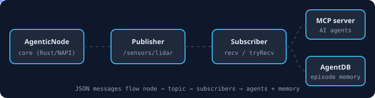

# @agentic-robotics/cli

[](https://www.npmjs.com/package/@agentic-robotics/cli)
[](https://www.npmjs.com/package/@agentic-robotics/cli)
[](https://github.com/ruvnet/agentic-robotics)



Command-line tools for the **agentic-robotics** framework.

## Features

- 🛠️ **Test Framework** - Validate node creation and communication
- 📊 **System Info** - Display framework version and capabilities
- ⚡ **Quick Testing** - Rapid prototyping and debugging
- 🔍 **Diagnostics** - Built-in health checks
- 🎯 **Simple Interface** - Easy-to-use commands

## Installation

Global installation (recommended):

```bash
npm install -g @agentic-robotics/cli
```

Or use with npx:

```bash
npx @agentic-robotics/cli test
```

## Commands

### `test` - Test Node Communication

Test node creation, publisher, and message publishing:

```bash
agentic-robotics test
```

### `doctor` - System Diagnostics 🏥

Run comprehensive system diagnostics to check your environment:

```bash
agentic-robotics doctor
```

**Verbose mode:**
```bash
agentic-robotics doctor --verbose
```

**Output:**
```
🏥 Running Agentic Robotics Doctor...

📋 Checking Node.js version...
   ✅ Node.js v18.20.8 (>= 14.0.0 required)

📋 Checking @agentic-robotics/core...
   ✅ Core package loaded
   ✅ Node creation works

📋 Checking optional integrations...
   ✅ agentic-flow available (66 agents + 213 MCP tools)
   ✅ AgentDB available (13,000x faster memory)
   ✅ MCP server available

📋 Checking system resources...
   💾 Memory: 4.50 GB free / 8.00 GB total
   🖥️  CPUs: 4 cores

═══════════════════════════════════════════════════════
🎉 Doctor says: Everything looks good!
═══════════════════════════════════════════════════════
```

### `dialog` - Interactive Mode 🤖

Enter interactive dialog mode to work with the robotics framework:

```bash
agentic-robotics dialog
```

**Interactive commands:**
```
agentic> help
Available commands:
  help          - Show this help message
  info          - Show framework information
  create <name> - Create a new node
  pub <topic>   - Create publisher on topic
  send <msg>    - Publish message
  stats         - Show publisher statistics
  status        - Show current session status
  agents        - List available AI agents
  clear         - Clear screen
  exit          - Exit dialog mode

agentic> create my-robot
✅ Node "my-robot" created successfully

agentic> pub /commands
✅ Publisher created on topic: /commands

agentic> send Move forward 10 meters
✅ Message sent: "Move forward 10 meters"

agentic> stats
📊 Publisher Statistics:
   Messages: 1
   Bytes: 53
```

### `agents` - List AI Agents 🌊

List available AI agents with optional filtering:

```bash
agentic-robotics agents
```

**Filter by category:**
```bash
agentic-robotics agents --category core
agentic-robotics agents --category swarm
agentic-robotics agents --category flow
```

**Output:**
```
🤖 Available AI Agents

📦 Core Robotics Agents:
   • AgenticNode       - Core node for pub/sub communication
   • AgenticPublisher  - High-performance message publisher
   • AgenticSubscriber - Message subscriber with callbacks

🌊 Swarm Coordination (via agentic-flow integration):
   • hierarchical-coordinator - Queen-led hierarchical coordination
   • mesh-coordinator         - Peer-to-peer mesh network
   • adaptive-coordinator     - Dynamic topology switching
   • collective-intelligence  - Distributed cognitive processes
   • swarm-memory-manager     - Distributed memory coordination

🔧 Task Agents (66 total via agentic-flow):
   Development:
   • coder, reviewer, tester, planner, researcher

   Specialized:
   • backend-dev, mobile-dev, ml-developer, system-architect
   • api-docs, cicd-engineer, production-validator

   GitHub Integration:
   • pr-manager, code-review-swarm, issue-tracker
   • release-manager, workflow-automation, repo-architect

   SPARC Methodology:
   • sparc-coord, specification, pseudocode, architecture, refinement
```

### `test` - Test Node Communication (Legacy)

Test node creation, publisher, and message publishing:

```bash
agentic-robotics test
```

**Output:**
```
🤖 Testing Agentic Robotics Node...
✅ Node created successfully
✅ Publisher created
✅ Message published
✅ Message received
📊 Stats: { messages: 1, bytes: 66 }
```

### `info` - Framework Information

Display framework version and capabilities:

```bash
agentic-robotics info
```

**Output:**
```
🤖 Agentic Robotics Framework v0.1.3
📦 ROS3-compatible robotics middleware
⚡ High-performance native bindings

Available commands:
  test     - Test node creation and communication
  info     - Show this information
```

## Quick Start

### Test Your Installation

```bash
# Install globally
npm install -g @agentic-robotics/cli

# Run test
agentic-robotics test

# Should output: ✅ All tests passed
```

### Use in Scripts

```json
{
  "scripts": {
    "test:robot": "agentic-robotics test",
    "info": "agentic-robotics info"
  }
}
```

## Usage Examples

### CI/CD Integration

```yaml
# .github/workflows/test.yml
name: Test Robot Framework

on: [push]

jobs:
  test:
    runs-on: ubuntu-latest
    steps:
      - uses: actions/checkout@v3
      - uses: actions/setup-node@v3
        with:
          node-version: '18'
      - run: npm install -g @agentic-robotics/cli
      - run: agentic-robotics test
```

### Docker Health Check

```dockerfile
FROM node:18
RUN npm install -g @agentic-robotics/cli
HEALTHCHECK CMD agentic-robotics test || exit 1
```

### Pre-commit Hook

```bash
#!/bin/bash
# .git/hooks/pre-commit
agentic-robotics test || {
  echo "❌ Robot framework test failed"
  exit 1
}
```

## API

The CLI uses the `@agentic-robotics/core` package internally:

```javascript
const { AgenticNode } = require('@agentic-robotics/core');

// Test creates a node
const node = new AgenticNode('test-node');

// Creates a publisher
const publisher = await node.createPublisher('/test');

// Publishes a test message
await publisher.publish(JSON.stringify({
  message: 'Hello, World!',
  timestamp: Date.now()
}));

// Checks stats
const stats = publisher.getStats();
console.log('📊 Stats:', stats);
```

## MCP Server Binary

The `agentic-robotics` package also includes the **Model Context Protocol (MCP) server**:

```bash
agentic-robotics-mcp
```

This launches an interactive MCP server with:
- **Robot control tools**: move_robot, get_pose, get_status
- **Sensor tools**: read_lidar, detect_objects
- **Memory tools**: query_memory, consolidate_skills, get_memory_stats
- **AgentDB integration**: 13,000x faster memory (5,725 ops/sec)

The MCP server enables AI assistants (like Claude) to interact with the robotics framework through the Model Context Protocol.

For more information, see [@agentic-robotics/mcp](https://www.npmjs.com/package/@agentic-robotics/mcp).

## Exit Codes

- `0` - Success (all tests passed)
- `1` - Failure (test failed or error occurred)

## Requirements

- Node.js >= 14.0.0
- @agentic-robotics/core (peer dependency)

## Related Packages

- **[agentic-robotics](https://www.npmjs.com/package/agentic-robotics)** - Complete framework
- **[@agentic-robotics/core](https://www.npmjs.com/package/@agentic-robotics/core)** - Core bindings
- **[@agentic-robotics/mcp](https://www.npmjs.com/package/@agentic-robotics/mcp)** - MCP server

## Homepage

Visit [ruv.io](https://ruv.io) for more information and documentation.

## License

MIT OR Apache-2.0
