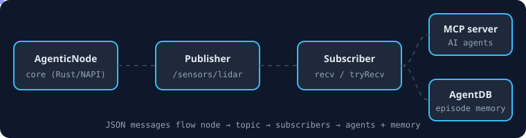

# @agentic-robotics/linux-arm64-gnu



Native bindings for **agentic-robotics** on Linux arm64 (GNU libc).

This package contains the precompiled native binary for the agentic-robotics framework. It is installed automatically as an optional dependency of `@agentic-robotics/core` on a matching platform; you should not need to install it directly.

```bash
npm install @agentic-robotics/core
```

## Compatibility

Requires glibc 2.34 or newer (the binary links `GLIBC_2.34` symbols), for example Ubuntu 22.04+, Debian 12+ (including Raspberry Pi OS 12 "bookworm") and RHEL 9+. Older distributions fail to load the binary with a `GLIBC_2.34 not found` error. musl-based distributions such as Alpine are not supported.

The binary is built by the `release-native` workflow in [ruvnet/agentic-robotics](https://github.com/ruvnet/agentic-robotics) and is not committed to the repository.

## Quick start

```bash
npm install @agentic-robotics/core
node -e "const { AgenticNode } = require('@agentic-robotics/core'); new AgenticNode('demo').createPublisher('/demo').then(async p => { await p.publish(JSON.stringify({ ok: true })); console.log(p.getStats()); })"
# { messages: 1, bytes: 11 }
```

## License

MIT OR Apache-2.0
